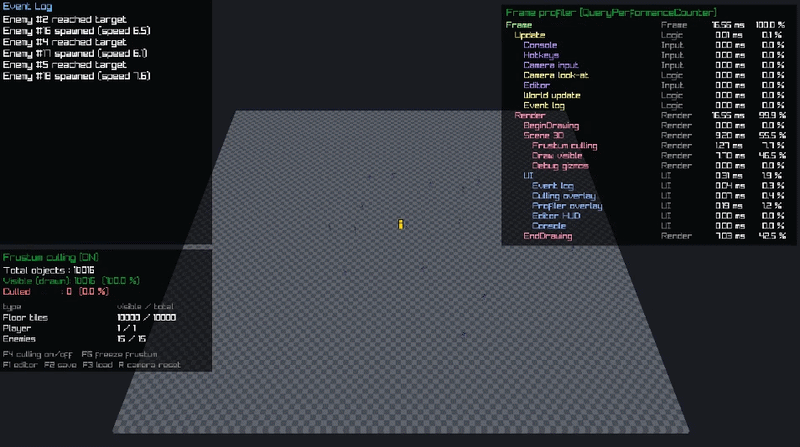
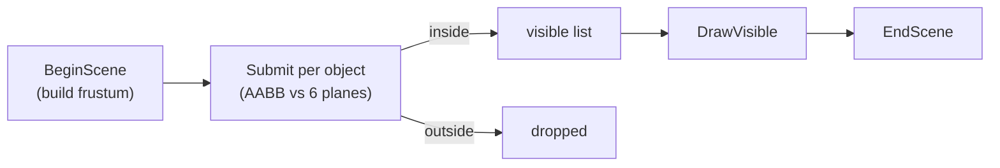
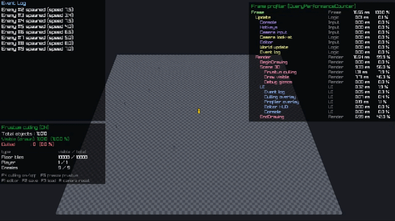
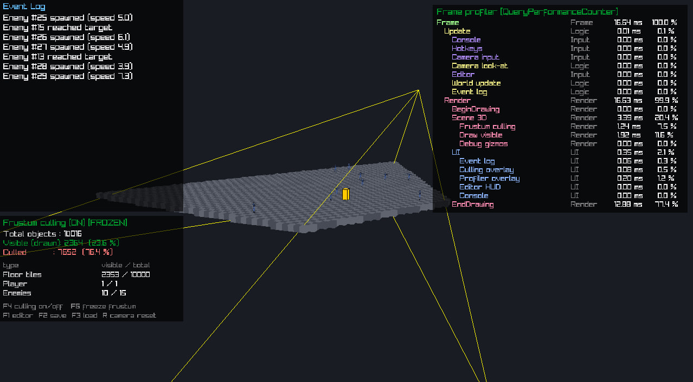
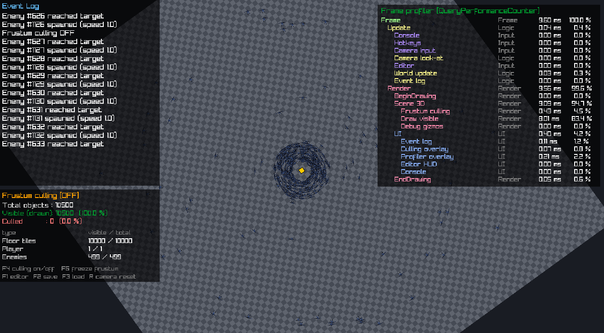
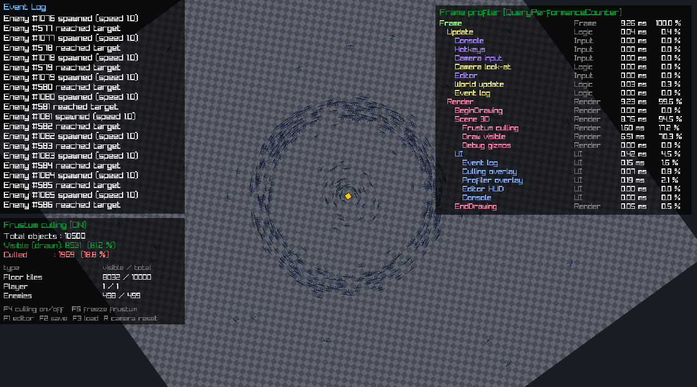
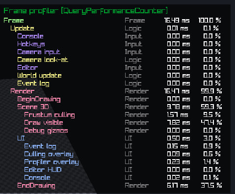
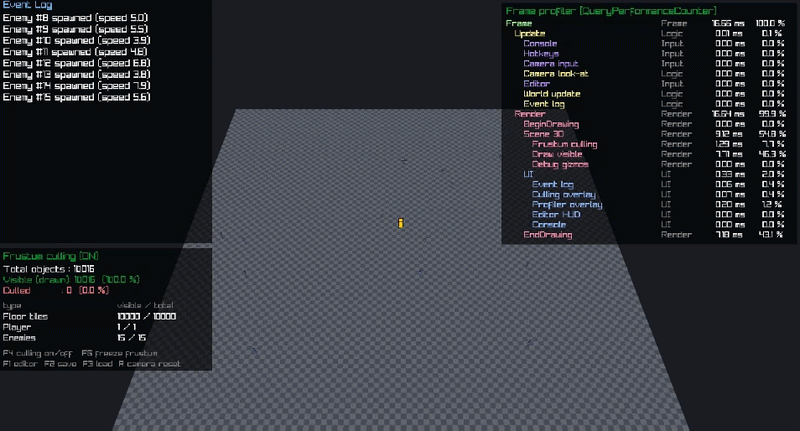
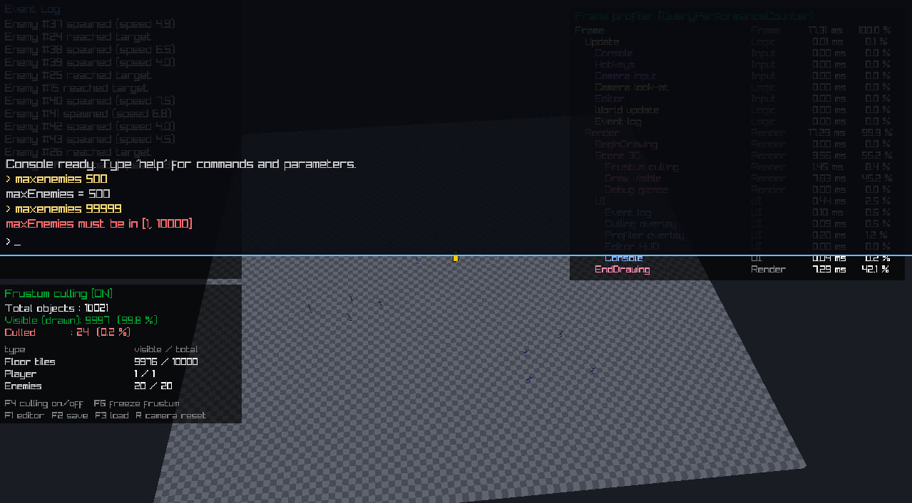

<h1 align="center">Raylib Engine Project</h1>
<p align="center">
  <b>A small C++17 engine on raylib: game-object world, view-frustum culling with a measured cost, frame profiler, console and level editor</b><br>
  C++17 · raylib 5.5 · CMake · AABB frustum culling · Instrumentation profiler · Windows
</p>
<p align="center">
  
  
  
  
  
  
  
</p>

A playground for engine architecture and performance work. One `GameWorld` owns every object (a 100×100 floor of 10,000 separate tiles, editor-placed cubes and walls, and up to 10,000 enemies, each a 50,000-triangle model), a renderer culls them against the camera frustum, and a built-in profiler shows what every step costs. It is not a finished game.

**Result:** at 100 enemies, with about 20 % of the scene outside the view, the culling step costs ~0.9 ms per frame and removes ~1.5 ms of drawing: **9.05 ms → 8.39 ms (-7 %)**. When everything is on screen it is a pure loss (**9.23 ms → 10.50 ms**), so in this scene about 12-15 % of the objects have to be outside the view before culling pays for itself.

<p align="center"></p>

## Contents

- [Highlights](#highlights)
- [Frustum culling](#frustum-culling)
- [Performance](#performance): [Method](#method) · [Results](#results) · [Reproduce](#reproduce-the-measurements)
- [Level editor](#level-editor)
- [Console and parameters](#console-and-parameters)
- [Controls](#controls)
- [Build and run](#build-and-run)
- [Project layout](#project-layout)
- [Testing](#testing)
- [What the measurements taught me](#what-the-measurements-taught-me)
- [Limitations and next steps](#limitations-and-next-steps)
- [License and credits](#license-and-credits)

## Highlights

- **Culling you can inspect.** The frustum is built from the camera basis and lens, and the AABB test is conservative: a visible object is never culled. **F6** freezes the frustum and draws it, so you can fly outside and see exactly what it drops.
- **Cost measured, not assumed.** Culling and drawing are separate steps with their own profiler scopes, so the overhead and the saving are both visible. The [results](#results) include the case where culling loses.
- **One world, one owner.** `GameWorld` owns all objects as `unique_ptr<GameObject>` and updates only the dynamic ones, so 10,000 static tiles cost nothing per update.
- **Instrumentation profiler.** RAII scope markers build a per-frame tree of timings, drawn as an on-screen overlay.
- **Level editor.** Mouse picking, stacking on top of other objects, grid snapping and an atomic save/load of a plain-text level file.
- **Console with validated parameters.** Change spawn rate, enemy speed and enemy cap at runtime, or reload them from a config file. Bad values are rejected with an error and change nothing.

## Frustum culling

Every frame the renderer builds the six frustum planes, tests each object's AABB against them (centre and extents; `s < -r` for any plane means outside) and draws only the visible list.



Freeze the frustum by pressing **F6**, then fly away with WASD: the yellow frustum is drawn, and only the objects inside it are drawn.

<p align="center"></p>

<p align="center"></p>

## Performance

Every number below was read from the engine's own profiler overlay. Where a number is an estimate or a single run, the text says so.

| Scene | Frame time, culling OFF → ON |
|---|---|
| 100 enemies, overview camera (100 % of objects visible) | 9.23 → 10.50 ms (**+1.27 ms, +14 %**): pure overhead |
| 100 enemies, closer camera (80 % visible) | 9.05 → 8.39 ms (**-0.66 ms, -7 %**) |
| 500 enemies, closer camera (81 % visible), single run | 9.60 → 9.26 ms (**-0.34 ms, -4 %**) |

### Method

- **Machine:** AMD Ryzen 9 7900X (12 cores / 24 threads), 32 GB RAM, NVIDIA GeForce RTX 4070 12 GB (driver 32.0.16.1088), Windows 11 Pro (build 26300), MSVC 19.44.
- **Build:** x64 Release, 1280×720, vsync off, `fps 0` (uncapped).
- **Tools:** the profiler overlay (Windows `QueryPerformanceCounter`) and the culling overlay (visible / total objects).
- **Scene:** `level.map` loaded with F3, the enemy count at its cap (`100 / 100` or `500 / 500` in the overlay) during every reading, camera fixed, no input while reading. The scene has 10,000 floor tiles, 1 player and N enemies.
- **Reading:** the value shown 10 seconds after the scene settled. The profiler shows one frame at a time, so readings move by about ±0.3 ms between runs. Readings taken right after toggling culling were discarded because they were not settled.
- **Runs:** 100-enemy rows are the mean of 2 runs; the 500-enemy row is a single run.

### Results

| Enemies | Camera | Culling | Frame (ms) | Frustum culling (ms) | Draw visible (ms) | Visible / total |
|---:|---|---|---:|---:|---:|---:|
| 100 | overview | OFF | 9.23 | 0.53 | 7.96 | 10,101 / 10,101 (100 %) |
| 100 | overview | ON | 10.50 | 1.47 | 7.93 | 10,101 / 10,101 (100 %) |
| 100 | closer | OFF | 9.05 | 0.43 | 7.88 | 10,101 / 10,101 (100 %) |
| 100 | closer | ON | 8.39 | 1.34 | 6.39 | 8,132 / 10,101 (80.5 %) |
| 500 | closer | OFF | 9.60 | 0.43 | 8.01 | 10,501 / 10,501 (100 %) |
| 500 | closer | ON | 9.26 | 1.60 | 6.51 | 8,531 / 10,501 (81.2 %) |

<table>
  <tr>
    <td></td>
    <td></td>
  </tr>
  <tr>
    <td align="center">Culling OFF</td>
    <td align="center">Culling ON (same camera, same scene)</td>
  </tr>
</table>



What the numbers show:

- **Culling is a trade.** The test adds about 0.9-1.2 ms for ~10,000 objects (roughly 90-110 ns each; the OFF rows still pay for the submit loop). Each object it removes saves about 0.75 µs of drawing (1.5 ms for ~1,970 objects), so the break-even is roughly 12-15 % of the scene outside the view. That figure is an estimate from two data points.
- **With everything in view it only costs.** In the overview, Draw visible is the same with culling ON and OFF (7.93 vs 7.96 ms), and the frame gets 1.27 ms slower (the culling scope itself adds 0.94 ms).
- **Only floor tiles were culled.** All enemies were inside the view (`100 / 100`, `500 / 500`), so the saving came from the floor alone. It would grow if enemies were also off-screen.
- **Enemy count matters less than the triangle count suggests.** Going from 100 to 500 enemies (about 20 million more triangles) added only ~0.1 ms to Draw visible with culling OFF (and ~0.5 ms to the whole frame). Most of the drawing time is the 10,000 floor tiles.

**Scope of these numbers.** One machine, one scene, a by-hand overlay reading rather than an averaged capture. The "closer" camera hides only about 20 % of the scene, not the extreme close-up, and the 500-enemy row is a single run. Treat the table as a measurement, not a benchmark suite.

### Reproduce the measurements

1. Run the Release build and press **F3** to load the demo level.
2. In the console (`~`): `fps 0`, `spawnPeriod 0.01`, `maxEnemies 500`.
3. Wait until the **Enemies** row in the culling overlay shows `500 / 500`, then leave the camera alone.
4. Wait 10 seconds and read **Frame**, **Frustum culling** and **Draw visible** from the profiler with **F4** ON, then OFF. To compare cameras, change the `camera` line in `level.map` and reload with F3.

`maxEnemies` is only a ceiling. The enemy count settles at (spawn rate × enemy lifetime), so with the default settings you only get about 20 enemies. A short `spawnPeriod` (and, for large counts, slower enemies with `minEnemySpeed` / `maxEnemySpeed`) is needed to reach the cap.

## Level editor

<p align="center"></p>

Press **F1** to toggle the editor (the simulation pauses while it is on). The mouse ray picks the nearest cube or wall, or the floor plane. The new object is placed on that surface, so clicking the top of a cube stacks on it, and positions snap to the 1-unit floor grid.

Levels are stored in `level.map`, a human-readable text file:

```text
# level.map v1
player <x> <y> <z>                       player spawn (centre of the player box)
camera <x> <y> <z>                       camera point
cube   <cx> <cy> <cz> <sx> <sy> <sz>     static box: centre + size
wall   <cx> <cy> <cz> <sx> <sy> <sz>
```

Loading is atomic: the file is fully parsed first, and a bad file changes nothing.

## Console and parameters

Press **`~`** to open the console (**Esc** closes it). Type a parameter name and a value to set it, or just the name to print it.

<p align="center"></p>

| Parameter | Meaning | Range | Default |
|---|---|---|---:|
| `spawnPeriod` | seconds between enemy spawns | 0.01 - 3600 | 0.4 |
| `minEnemySpeed` | minimum enemy speed (units/s) | 0.01 - 1000 | 3 |
| `maxEnemySpeed` | maximum enemy speed (units/s) | 0.01 - 1000 | 8 |
| `maxEnemies` | maximum enemies alive at once | 1 - 10000 | 15 |
| `logLifetime` | seconds an event log line stays on screen | 0.1 - 3600 | 3 |

Commands: `help`, `clear`, `fps <n>` (0 = uncapped), `ReloadConfig`.

Parameters can also be loaded from a `params.cfg` file next to `CMakeLists.txt` (`name value` or `name=value`; `#` and `//` start comments). Press **F5** or run `ReloadConfig` to apply it. As with levels, a file with any error changes nothing.

## Controls

| Key | Action |
|---|---|
| **F1** | editor on/off (pauses the simulation) |
| **1 / 2 / 3 / 4** | editor tool: cube 1×1×1 / wall 10×10×1 / player spawn / camera point |
| **Tab** | rotate the wall 90° |
| **LMB / RMB** | add the current object / remove the cube or wall under the cursor |
| **F2 / F3** | save / load `level.map` |
| **F4** | frustum culling on/off |
| **F5** | reload `params.cfg` |
| **F6** | freeze the frustum and draw it |
| **WASD / arrows** | move the camera (it always looks at the player) |
| **R** | put the camera back on the camera point |
| **`~`** | console |
| **Esc** | close the console, or quit |

## Build and run

**Requirements:** CMake 3.16+ and a C++17 compiler. CMake uses an installed raylib 5.x if it finds one, otherwise it downloads raylib 5.5 (network access needed during configure).

```bash
git clone https://github.com/xzhka/raylib-mini-engine.git
cd raylib-mini-engine
cmake -S . -B build
cmake --build build --config Release
```

Run `build/Release/raylib-mini-engine.exe` (MSVC) or `build/raylib-mini-engine` (other generators), then press **F3** to load the demo level. Always time the Release build; a Debug build tells you nothing.

Asset and level paths are set at configure time through `ASSETS_DIR` and `LEVEL_FILE_PATH`, so the program finds its files wherever it is started from. Re-run CMake if you move the folder.

Developed and measured on Windows with MSVC. On Linux, raylib needs the usual X11 and OpenGL development packages. The code has a `std::chrono` clock fallback for non-Windows builds, but I have not tested them yet.

## Project layout

```text
src/
├── Application.*        main loop, hotkeys, wiring
├── camera/              GameCamera (look-at-player), CameraController (input)
├── console/             Console UI, CommandProcessor (parsing, no drawing or input)
├── core/                Config, ConfigLoader, ParameterRegistry, Clock, Window
├── editor/              LevelEditor (picking, placement, gizmos, HUD)
├── render/              Frustum (planes + AABB test), Renderer (Submit / DrawVisible)
├── tools/               Profiler, ScopeMarker (RAII), overlays, EventLog
└── world/               GameWorld, GameObject, Enemy, EnemySpawner, StaticBox,
                         ModelAsset, LevelFile, player and camera markers
assets/enemy.glb         shared enemy model (50,000 triangles)
level.map                demo level
docs/img/                README media
```

About 2,900 lines of C++.

**Design notes**

- **One list owns, one list updates.** `GameWorld` owns all objects as `unique_ptr<GameObject>`. `Update()` walks a second list, `Updatables`, with only the dynamic objects.
- **Deferred destruction.** `Destroy()` only sets a flag, and the world sweeps once per frame, so an object can safely remove itself in the middle of the update loop.
- **Culling and drawing are separate.** `Submit` tests and collects, `DrawVisible` draws. That is what lets the profiler attribute the cost to each step.
- **Validated input everywhere.** Console values, config files and level files are all checked before anything is changed.
- **Explicit timing scopes.** Profiler scopes are RAII markers (`PROFILE_SCOPE("name", "category")`), so the timing tree matches the code structure.

## Testing

There is no test framework yet. Correctness is checked by inspection:

- **Frozen frustum (F6):** fly around the yellow frustum and check that everything inside it is drawn and everything outside is dropped.
- **Counts:** with culling ON and the whole scene in view, the overlay reports `10,101 / 10,101` visible, so nothing visible is dropped. With the closer camera, all enemies stayed visible (`100 / 100`, `500 / 500`) while only floor tiles outside the view were culled.

## What the measurements taught me

1. **`maxEnemies` is a ceiling, not a target.** The enemy count settles at spawn rate × enemy lifetime. With the defaults that is about 20 enemies, however high the cap is, so reaching 100 or 500 needed a much shorter `spawnPeriod`.
2. **Culling can lose.** In the overview camera, where nothing can be culled, it made every frame 1.27 ms slower. An optimization needs a measurement in the case where it should not help, not only where it does.
3. **The expensive part was not the one the numbers suggested.** 500 enemies are 25 million triangles, yet going from 100 to 500 enemies added only ~0.1 ms of drawing. The 10,000 floor tiles dominate, which is why culling mostly removes tiles.

## Limitations and next steps

- Culling tests every object linearly, every frame (O(n)), at about 90-110 ns per object. A spatial grid or BVH would skip whole groups of tiles at once and lower the break-even point.
- The floor is 10,000 separate objects on purpose (so each can be culled), but a real renderer would batch or instance them.
- There is no gameplay layer yet: the camera is controllable, but enemies simply walk toward the player and disappear.
- No automated tests yet. `Frustum::Intersects` is the first target: box inside, outside, straddling a plane, behind the camera, touching a plane, plus a random-box check that it never rejects a visible box.
- Timings are read by hand from an overlay. A `bench` command that averages N frames and writes a CSV would make them reproducible.
- Only tested on Windows.

## License and credits

Code: MIT, see [LICENSE](LICENSE).

`assets/enemy.glb` is derived from "Invincible" by **zandervimal** ([Sketchfab](https://sketchfab.com/3d-models/invincible-111b3912bc524a8b887ddd629ec94b71), licensed [CC-BY-4.0](https://creativecommons.org/licenses/by/4.0/)). Changes made: skeleton removed, Z-up converted to Y-up, pivot moved to the feet, texture reduced from 4096² to 2048². The geometry is unchanged (50,000 triangles).